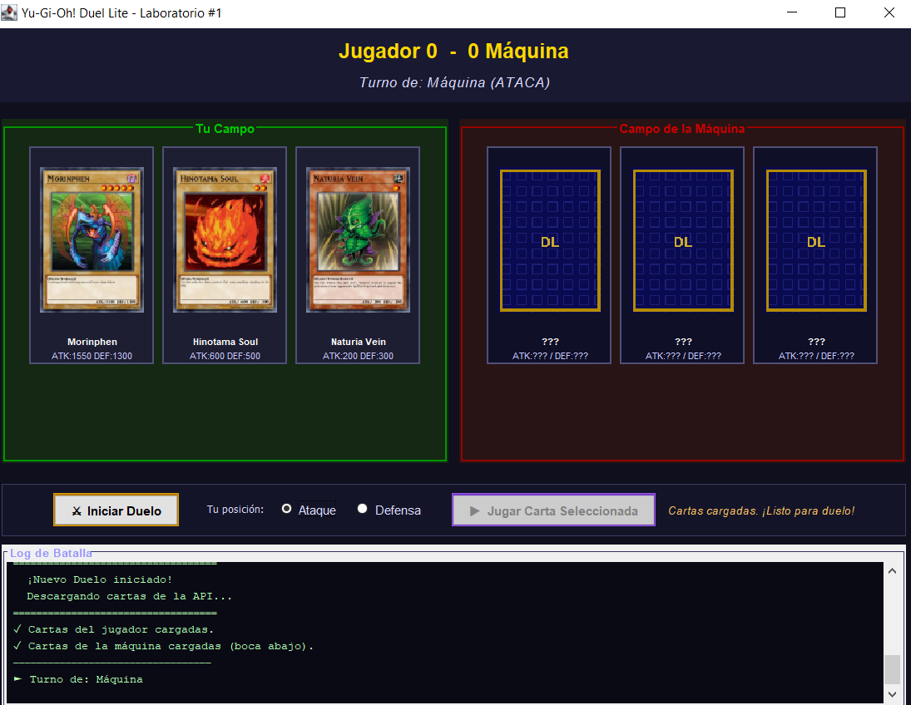
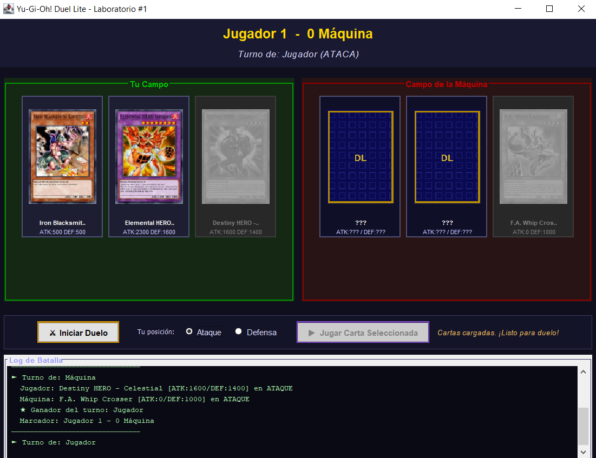
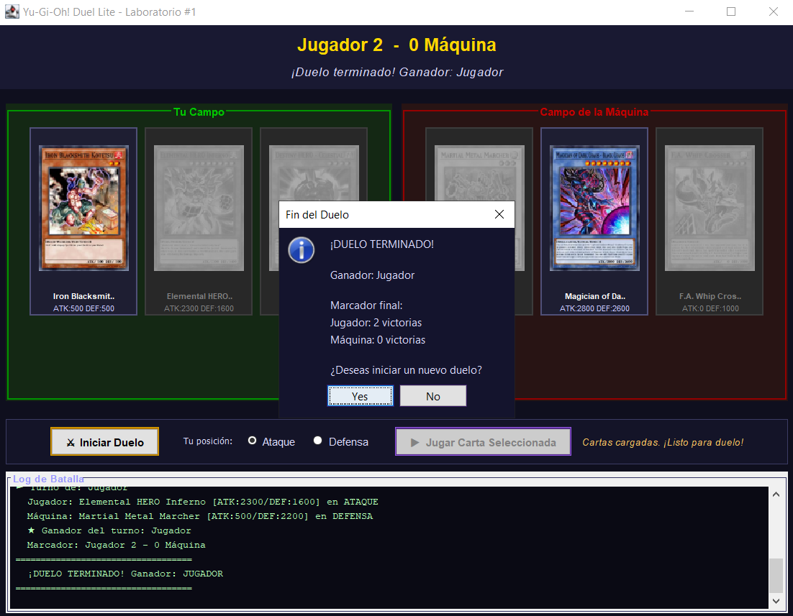

# Yu-Gi-Oh! Duel Lite

**Laboratorio #1 — Desarrollo de Software III**
Universidad del Valle, Sede Tuluá

| Integrante | Código |
|---|---|
| Michael Pérez | 2266121 |
| Santiago Sánchez | 2359606 |

**Docente:** Mg(c). Juan Pablo Pinillos Reina

---

## Descripción

Aplicación de escritorio en Java Swing que simula un duelo sencillo de Yu-Gi-Oh! entre un jugador humano y la máquina. Cada jugador recibe 3 cartas Monster aleatorias obtenidas en tiempo real de la API pública **YGOProDeck**. El duelo se juega en rondas por turnos: quien gane 2 de 3 rondas gana el duelo.

---

## Requisitos

- **JDK 11 o superior** (se recomienda JDK 17 LTS)
- **IntelliJ IDEA** (Community o Ultimate)
- **Conexión a internet** (para consultar la API de YGOProDeck y descargar las imágenes de las cartas)

> No es necesario tener Maven instalado por separado: IntelliJ trae Maven integrado.

---

## Cómo ejecutar

### 1. Descargar el repositorio

Clonar con Git:
```bash
git clone <url-del-repositorio>
```
O descargar el ZIP desde GitHub → **Code → Download ZIP** y descomprimirlo.

### 2. Abrir en IntelliJ IDEA

1. Abrir IntelliJ IDEA.
2. Ir a **File → Open** y seleccionar la carpeta del proyecto (la que contiene `pom.xml`).
3. Cuando IntelliJ pregunte, elegir **"Trust Project"**.

### 3. Importar como proyecto Maven

En el panel izquierdo, hacer **clic derecho sobre `pom.xml`** → seleccionar **"Add as Maven Project"**.

IntelliJ descargará automáticamente las dependencias. Esperar a que termine (se ve en la barra inferior).

### 4. Ejecutar la aplicación

Abrir el archivo `src/main/java/co/edu/univalle/duellite/Main.java` y hacer clic en el triángulo verde ▶ que aparece junto al método `main`.

---

## Capturas de pantalla

### Cartas cargadas — listas para el duelo


### Duelo en progreso


### Anuncio del ganador


---

## Diseño del proyecto

El proyecto sigue una separación clara en cuatro capas:

- **`model`**: Contiene `Card` (los datos de una carta: nombre, ATK, DEF, imagen) y `Position` (enum ATAQUE/DEFENSA). Son clases simples de datos sin dependencias externas.
- **`api`**: `YgoApiClient` encapsula toda la comunicación HTTP con la API de YGOProDeck usando el `HttpClient` de Java 11. Valida el tipo de carta, maneja los dos formatos posibles de respuesta JSON, descarta cartas inválidas y lanza `ApiException` con mensajes claros ante cualquier fallo de red o HTTP.
- **`logic`**: `Duel` contiene las reglas del juego de forma completamente independiente de Swing. No importa ni una clase del paquete `javax.swing`. Se comunica con la interfaz gráfica exclusivamente a través de la interfaz `BattleListener`, lo que facilita las pruebas unitarias y desacopla totalmente la lógica de la presentación.
- **`ui`**: `MainFrame` implementa `BattleListener` y actúa como controlador de la vista. `CardPanel` encapsula la representación gráfica de una carta individual.

Para evitar bloquear el **Event Dispatch Thread (EDT)** de Swing, todas las peticiones HTTP y descargas de imágenes se realizan dentro de `SwingWorker`. El método `done()` del worker (que corre en el EDT) es el único lugar donde se modifican los componentes de la interfaz tras una operación en segundo plano.

---

## Reglas del juego implementadas

1. **Turno inicial**: se decide al azar al crear el duelo.
2. **Turno**: quien tiene el turno **ATACA**. El oponente elige su posición (ATAQUE o DEFENSA). El jugador elige con radio buttons; la máquina elige al azar.
3. **Comparación**:
   - *Ambos en ATAQUE*: gana el mayor ATK.
   - *Atacante vs Defensor en DEFENSA*: se compara el ATK del atacante con la DEF del defensor. Si ATK > DEF gana el atacante; si DEF > ATK gana el defensor.
4. **Desempate**: si la comparación principal empata, se compara la otra estadística (DEF en ataque-ataque, ATK en ataque-defensa). Si sigue empatado, gana quien tiene el turno (el atacante).
5. **Fin del duelo**: gana quien llegue primero a 2 victorias de ronda.
6. **Cartas sin DEF** (Link Monsters): se descartan en el cliente de la API y se solicita otra carta. Esto garantiza que todas las cartas en el juego tienen DEF definida.

---

## Estructura de paquetes

```
Lab1/
├── pom.xml
├── README.md
├── Screenshots/
│   ├── CartasCargadas.png
│   ├── Duelo.png
│   └── MensajeGanador.png
└── src/
    ├── main/
    │   └── java/
    │       └── co/edu/univalle/duellite/
    │           ├── Main.java                  ← Punto de entrada
    │           ├── model/
    │           │   ├── Card.java              ← Datos de una carta
    │           │   └── Position.java          ← Enum ATAQUE/DEFENSA
    │           ├── api/
    │           │   ├── YgoApiClient.java      ← Cliente HTTP + parseo JSON
    │           │   └── ApiException.java      ← Excepción de la API
    │           ├── logic/
    │           │   ├── Duel.java              ← Reglas y estado del duelo
    │           │   └── BattleListener.java    ← Interfaz de eventos
    │           └── ui/
    │               ├── MainFrame.java         ← Ventana principal
    │               └── CardPanel.java         ← Vista de una carta
    └── test/
        └── java/
            └── co/edu/univalle/duellite/
                └── logic/
                    └── DuelTest.java          ← Pruebas unitarias de Duel
```

---

## Dependencias

| Dependencia | Versión | Uso |
|---|---|---|
| `org.json:json` | 20240303 | Parseo de respuestas JSON de la API |
| `org.junit.jupiter:junit-jupiter` | 5.10.2 | Pruebas unitarias (solo en test) |
